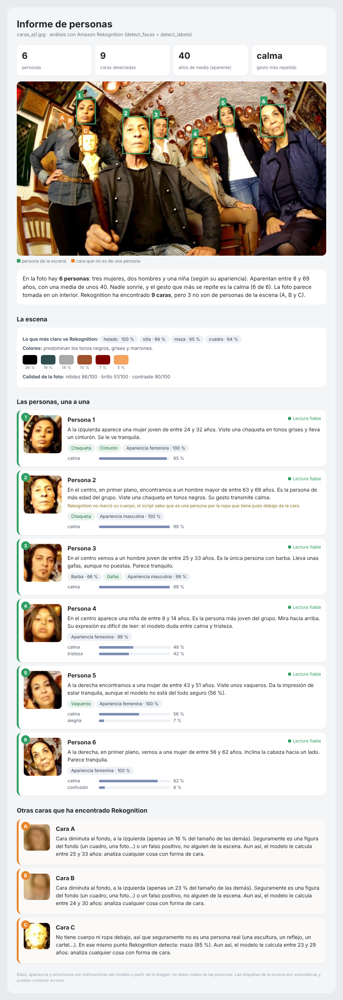
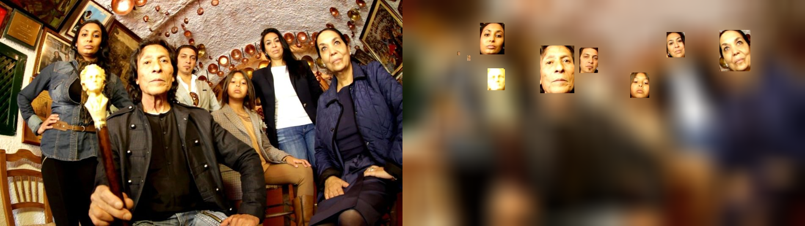
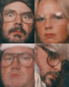
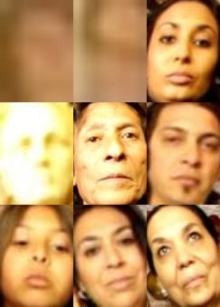
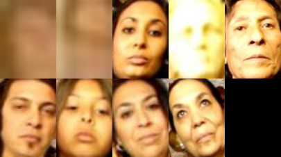

# Práctica 3.3 · Amazon Rekognition + OpenCV

Práctica de la asignatura de Inteligencia Artificial (2.º DAM, IES Zaidín-Vergeles).
Detección y análisis de caras con **Amazon Rekognition** y tratamiento de imagen con **OpenCV**, desde Google Colab.

📓 Notebook: [`practica_3_3_aws_rekognition.ipynb`](practica_3_3_aws_rekognition.ipynb)

## Ejercicio 1 · Informe narrado de las personas de una foto

El script no se limita a listar datos: genera un informe con una descripción personalizada de cada persona.

1. **Analiza la foto dos veces**: `detect_faces` (edad, género aparente, emociones, gafas, barba...) y `detect_labels` (cuerpos, ropa, objetos, colores y calidad de la escena).
2. **Cruza los dos análisis** para saber qué caras son de personas reales: una cara solo cuenta como persona si tiene un cuerpo o ropa justo debajo. Así descarta caras diminutas del fondo y objetos con forma de cara (en la foto de prueba, un busto).
3. **Redacta una descripción de cada persona** eligiendo sus 3 rasgos más destacados con esta puntuación:
   `seguridad del modelo × rareza en el grupo × interés del rasgo`.
   Así cada texto cuenta lo que diferencia a esa persona del resto (la única con barba, la más joven, su ropa...).
4. **Monta un informe en HTML** con la foto anotada, un resumen del grupo, la escena y una ficha por persona, y lo guarda en S3.

Informe completo: [`resultados/informe_ej1.html`](resultados/informe_ej1.html) (descárgalo y ábrelo en el navegador).

**Curiosidades que muestra el informe sobre los límites del modelo:** Rekognition está 100 % seguro de que en la escena hay un *helado* (probablemente el busto blanco del bastón), llama *maza* al bastón, no detecta el cuerpo del hombre en primer plano (el script lo reconoce por su chaqueta) y le calcula edad hasta a la escultura.

## Ejercicio 2 · Desenfocar todo menos las caras

Se desenfoca la imagen entera con `cv2.GaussianBlur` y después se copian encima, desde la imagen original, las regiones de las caras que devuelve Rekognition.

## Ejercicio 3 · Collage de caras

Se recortan todas las caras, se redimensionan al tamaño de la más grande y se colocan en una cuadrícula. Por defecto se usa el cuadrado más pequeño en el que caben todas (5 caras → 3x3); como ampliación, se pueden elegir filas y columnas a mano.

| 4 caras (2x2) | 9 caras (3x3) | 9 caras a medida (2x5) |
|---|---|---|
|  |  |  |

## Cómo ejecutarlo

1. Abre el notebook en Google Colab y sube `caras.jpg` y `caras_ej1.jpg`.
2. En la celda `%%writefile .env`, pon tu bucket y las credenciales de AWS Academy (Learner Lab → *AWS Details*). En el repositorio van sin credenciales a propósito.
3. Ejecuta las celdas en orden.

> Edad, género y emociones son estimaciones del modelo a partir de la apariencia, no datos reales de las personas.

Autor: Jesús Alarcón
